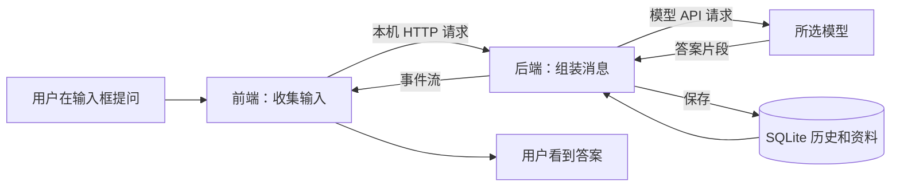

# 10：点击发送后发生什么——第一节源码追踪

日期：2026-10-30。范围：Agent Desk 本机 0.7.0 源码，只读追踪普通聊天。助教已核对代码入口，学习者独立追踪待验收。不是项目执行模式，没有新发付费模型请求。

## 本节只抓住三个角色

前端是用户看到的界面，负责收集输入和显示答案；后端是本机处理请求的程序，负责读取记录、组装上下文、调用模型和保存；模型是接收消息后生成内容的服务。后端既可以部署在云端，也可以像本项目一样运行在自己的电脑，不能把“后端”理解为必然是云服务器。

Electron 提供桌面窗口及本地能力宿主，React 管理页面内容；Express 在本机提供 HTTP 接口，SQLite 保存记录。当前阶段只需先将这些名称对应到职责，后续结合功能逐个学习。



## 从一个具体问题开始

假设输入“Mem0 的用途是什么？”，并选择已配置的 DeepSeek。这里只是数据示意，不是新一次模型运行记录。

第一步，界面读取草稿：src/main.jsx 的 sendMessage，第161行附近：

```javascript
const content = draft.trim();
```

draft 是输入框当前保存的文字，trim() 去除两端空白，content 是接下来要发送的文本。变量可以理解为代码为数据起的名字。它不是 API 请求，也还没有生成答案。

第二步，前端请求本机后端。sendMessage 第168行通过 api 辅助函数发送；简化阅读为：

```javascript
api('/sessions/会话编号/chat', {
  method: 'POST',
  body: { content, model, providerId }
});
```

这是讲解摘录，省略了真实代码里的 ID 编码、重新生成分支、流读取选项等，不能当作替换源码。POST 表示向该接口提交数据。content 是问题，model 是模型 ID，providerId 是应用内服务商记录的 ID，不是密钥。会话编号让后端知道应接到哪段历史后面。

src/api.mjs 第3行用 fetch('/api' + url, ...) 发出 HTTP 请求，并用 JSON.stringify 把 body 编码成 JSON。这一跳在当前应用所在的本机服务与界面之间进行，不是浏览器直接向 DeepSeek 发消息。x-agent-token 是保护本机接口的应用 token，与服务商 API Key 不同；本节不读取或展示真实凭据。

第三步，后端接住请求。server/app.mjs 第173行附近：

```javascript
app.post('/api/sessions/:id/chat', async (req, res) => {
  // 查找会话，加入问题，组装历史和资料，再调用模型。
});
```

:id 是会话编号的位置。req 是收到的请求，res 用来返回响应。async/await 用来组织需要等待的操作，具体语法以后结合代码学，不要求先背完整语法。

## 后端实际给模型准备了什么

app.mjs 第187–190行从 session.messages 中提取 role/content 作为 history，再用 extensions.context 组装有授权的记忆、技能和知识片段；有参考时加入 history。普通聊天不是自动把整个项目目录发给模型。

随后第207行调用 streamProvider。对于 chat-completions 协议，server/providers.mjs 第57行构造模型请求：

```javascript
messages: [{ role: 'system', content: SYSTEM }, ...history]
```

system 是整体行为要求，history 是已组织的消息列表。...history 表示展开列表里的各条消息。模型使用的是这次请求实际收到的内容，页面里存在但没有发送的内容不会自动进入上下文。

在这个项目里，普通聊天的发请求路径和“做项目”的执行引擎路径是分开的。本节的聊天路径不会因为模型回答“我修改了文件”就产生文件修改；真实文件操作要看任务引擎和执行记录。

## 为什么文字会一点点出现

模型接口逐段返回内容，providers.mjs 将不同协议转换为应用使用的片段。app.mjs 把片段累加，并用 text/event-stream 向前端发送 start、delta、done 三类事件。main.jsx 第170–180行不断读取这些事件，delta 到来时更新最后一条消息，所以页面逐步显示内容。

它不保证每个片段恰好一个字或一个 token，也不是前端拿到完整答案后再假装打字。本轮源码说明了数据通路，不代表已针对任意接口逐一验证流行为。

## 不花模型用量的追踪练习

1. 打开桌面应用的一条已有普通聊天，指认自己的输入、模型回复和选择的模型；不要点“重新生成”。
2. 按顺序在源码里查找 sendMessage → api → /api/sessions/:id/chat → streamProvider。
3. 对照上面的示例，把问题、会话编号、模型 ID 分别找到；只读代码，不复制真实凭据或生产数据库。
4. 画出“本机界面到后端”和“后端到模型”的两次请求。若只记住一件事：点击发送之后，应用先组织数据，再调用模型。

参考答案由助教讲解，学生独立解释另记：输入框文字来自 draft；前端 api/fetch 请求本机接口；后端从会话和授权资料构造 history；streamProvider 请求模型；delta 事件使界面更新；store.put 保存记录。当前只读追踪不等于已经独立掌握实现。

下一节学习“历史保存在哪、为什么重新打开还能继续”，沿同一条链路进入 server/store.mjs，不另造一个与项目无关的助手。
